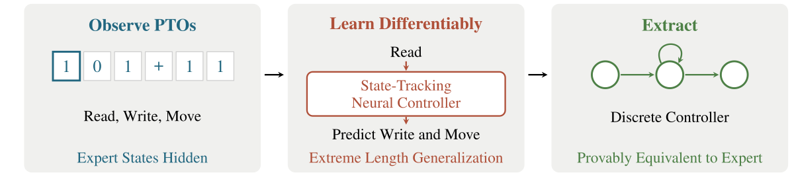
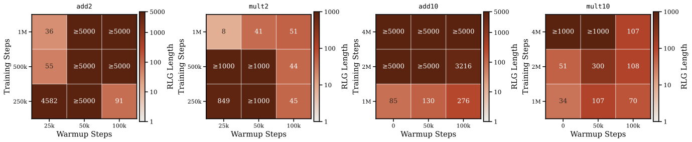
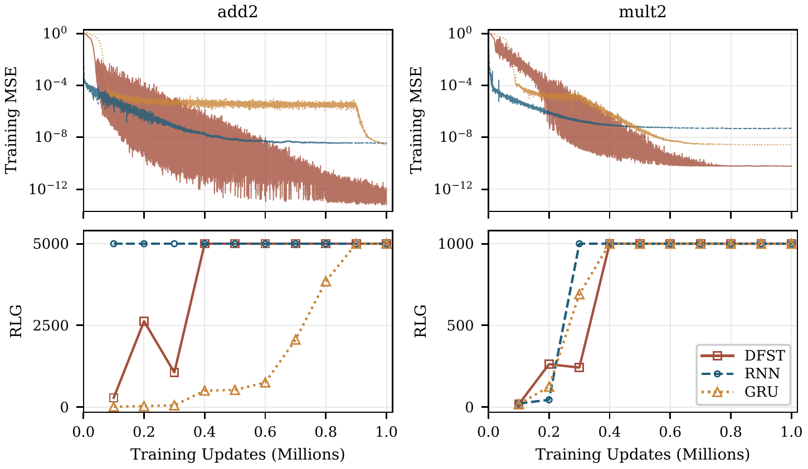
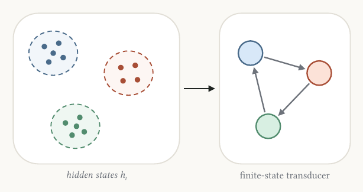
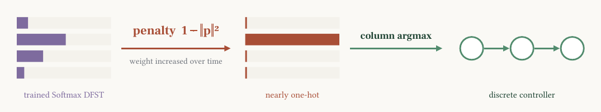

# DEL: Differentiable Exact Learning

Companion repository for **[Differentiable Exact Learning](https://arxiv.org/abs/2611.21486v1)**, NeurIPS 2026, by Hristo Papazov, Francesco D’Angelo, and Nicolas Flammarion.

**[Read the paper](https://arxiv.org/abs/2611.21486v1)** · **[Explore the results](paper/README.md)** · **[Open the grid explorer](https://fanagor.github.io/del/grid/)** · **[Quick start](#quick-start)**

Can a neural controller recover an algorithm from demonstrations alone? Each training example records a sequence of symbols read, symbols written, and head movements. The expert’s internal states remain hidden. We train controllers on these **policy-trajectory observations (PTOs)**, extract discrete transition rules, and prove when the recovered rules reproduce the expert on every valid input.



## Results at a glance


Selected DFSTs reach the evaluation caps of **5,000 digits for addition**, **1,000 digits for multiplication**, and **500 input symbols for universal simulation**, including held-out programs. At each tested length, evaluation checks the controller’s write and movement against every action in the sampled expert trajectories. The [summary notebook](notebooks/front_page_summary.ipynb) reconstructs the figure from the released evaluations.

## Paper runs and analyses

| To inspect | Start here |
|---|---|
| A particular experiment | [Released checkpoints, resolved configurations, and final evaluations](runs/README.md) |
| The runs behind a figure | [Figure selections](paper/figures.yaml) and [figure notebooks](paper/README.md) |
| How to train a controller | [Training recipes, overrides, and shell-loop examples](configs/README.md) |
| An extracted controller or proof | [Eight cases with transition tables, proof documents, and checkers](analyses/README.md) |

## Install

Use Python 3.10 or later. From the repository root, create an environment for the code and notebooks.

```sh
python -m venv .venv
source .venv/bin/activate
python -m pip install -e '.[dev,analysis]'
```

## Quick start

**Reproduce a figure.** Open the summary notebook and run all cells to regenerate the headline plot from saved results. The notebook reads the saved evaluations directly.

```sh
jupyter lab notebooks/front_page_summary.ipynb
```

**Inspect a configuration.** `del config` displays the package defaults. Add `--config` to load a YAML file, then append dotted overrides to preview a variation. The command prints the resolved settings without starting training or editing the file.

```sh
del config --config configs/DFST/add2.yaml
del config --config configs/DFST/add2.yaml data.size=50
```

**Train from a paper configuration.** Use the resolved configuration next to the checkpoint for the specific run. This example starts a full binary-addition training run and writes new outputs under `outputs/reproductions/`. Full paper runs can require substantial compute.

```sh
del train --config runs/DFST/add2/warmup_50000_steps_250000/config.yaml \
  run.device=auto run.output_dir=outputs/reproductions
```

For a short CPU example, checkpoint loading, custom evaluation, and the complete CLI, see the [implementation reference](docs/reference.md).

## Repository map

| Directory | Contents |
|---|---|
| [src/differentiable_exact_learning/](src/differentiable_exact_learning/) | Expert programs, simulators, neural controllers, training, evaluation, and extraction |
| [configs/](configs/README.md) · [runs/](runs/README.md) | Starting recipes and the 69 released final runs |
| [paper/](paper/README.md) · [notebooks/](notebooks/README.md) | Figure selections and executable analyses |
| [analysis_outputs/paper_figures/](analysis_outputs/paper_figures/) | Rendered plots and the values behind the figures |
| [analyses/](analyses/README.md) | Training histories, extracted machines, and proof bundles |
| [docs/](docs/reference.md) · [scripts/](scripts/README.md) · [tests/](tests/) | Implementation details, reproducibility tools, and tests |

## PTOs and expert controllers

An expert reads the cell under the head, chooses a symbol to write, moves the head, and updates a finite internal state. For arithmetic, the grid holds two operands and the workspace for addition or multiplication. For universal simulation, the grid holds an encoded binary Turing machine and an input word. The same interpreter executes different programs by reading different tables. A PTO records each read, write, and motion through the final stopping action. [Expert programs](src/differentiable_exact_learning/data/transitions/) · [Teaching sets](docs/teaching_sets.md)

## Neural controllers and training

A DFST selects three matrices from the current read symbol $x$. Applied to the current hidden vector, $A[x]$ produces the next hidden vector, $B[x]$ scores the written symbol, and $C[x]$ scores the motion. A Softmax DFST normalizes each matrix column into a probability distribution. RNN and GRU controllers use recurrent hidden-state updates with the same two prediction targets. The reported runs use Adam to fit expert actions with a masked mean-squared-error loss. During autonomous playback, each predicted write and movement determines the next observation. [Model implementations](src/differentiable_exact_learning/models/) · [Training reference](docs/reference.md#objective-and-optimization)

## Length generalization

The arithmetic sweeps compare generalization across training budgets and warmup schedules for DFSTs, and across hidden dimensions and dataset sizes for Softmax DFSTs. Uniform length generalization (ULG) tests sampled inputs. Robust length generalization (RLG) additionally tests structured repdigit pairs. The heatmaps show how the same architecture can reach different lengths under different schedules. [Arithmetic notebook](notebooks/dfst_arithmetic.ipynb) · [Universal simulation notebook](notebooks/dfst_universal.ipynb)



## Training dynamics across controller families

DFST, RNN, and GRU each reach both binary-task caps within one million updates, using 25 training PTOs for addition and 100 for multiplication. The loss curves summarize fitting on short training trajectories. The RLG curves show when each checkpoint succeeds on long, structured inputs. The runs use different dimensions, seeds, and schedules. [Six run histories and configurations](analyses/README.md#training-dynamics) · [Plotting notebook](notebooks/training_dynamics.ipynb)



## Extracting discrete controllers

**Metric extraction.** We collect hidden states from autonomous DFST trajectories and group nearby states by a distance threshold. Observed reads, writes, and movements supply the edges. Merging states with consistent transitions yields a deterministic controller over the observed behavior. [Metric extraction notebook](notebooks/metric_FST_extraction.ipynb)



**Softmax annealing.** We continue training a Softmax DFST with a progressively stronger penalty that concentrates the transition and action probabilities. A column-wise argmax selects a successor, write, and movement for each state and read symbol. [Annealing notebook](notebooks/anneal_dfst_softmax_to_fst.ipynb)



## Proofs of expert equivalence

The release contains **five metric-extraction proofs and three annealing proofs**. For example, the binary-addition proof covers all pairs of nonempty binary operands, including unequal lengths and leading zeros. The checker verifies finite transition obligations. The proof shows that the obligations cover every valid execution and establishes equivalence by induction. [Extracted binary-addition table](analyses/metric_extraction/DFST/add2/warmup_50000_steps_250000/machines/extracted.csv) · [Proof](analyses/metric_extraction/DFST/add2/warmup_50000_steps_250000/proof/equivalence_proof.pdf) · [Executable checker](analyses/metric_extraction/DFST/add2/warmup_50000_steps_250000/proof/verify_equivalence.py)

Each theorem specifies the input domain for the extracted discrete controller. Transferring the conclusion to continuous neural execution requires the paper’s additional stability or leakage assumptions. [All proof bundles](analyses/README.md) · [Paper and appendices](https://arxiv.org/abs/2611.21486v1)
