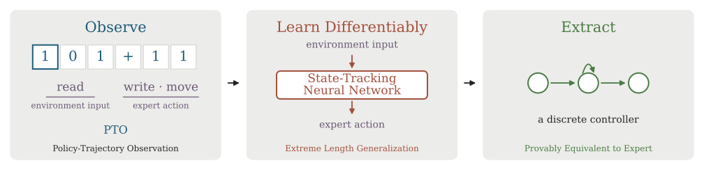

# DEL: Differentiable Exact Learning

DEL abbreviates **Differentiable Exact Learning**. The distribution uses
`differentiable-exact-learning`, Python imports use `differentiable_exact_learning`, and shell
commands start with `del`. Python reserves lowercase `del` as a keyword.

DEL learns algorithms from **policy-trajectory observations (PTOs)**: read symbols,
written symbols, and movements from expert executions. The controller receives
observations and action targets, never the expert's internal state.



Each PTO pairs environment inputs (read symbols) with expert actions (writes and movements)
over an execution. DEL trains a state-tracking neural network to predict those actions.
The [binary-addition case](analyses/metric_extraction/DFST/add2/warmup_50000_steps_250000/README.md)
includes an extracted finite-state discrete controller and a proof of exact agreement
with the expert for all nonempty binary operands.

<details>
<summary>Try the interactive binary-addition demo</summary>

After [installing DEL](#install), run:

```bash
del animate grid:add2 '101+11'
```

The command opens the expert execution in a local browser. Change the input,
pause playback, or advance one step at a time.
See the [viewer guide](#interactive-tape-and-grid-viewer) for more controllers
and trained-model playback.

</details>

This repository accompanies *Differentiable Exact Learning of Algorithms* and
contains arithmetic Turing machines, arithmetic grid agents, the universal
teleporting agent, and four differentiable controllers: **DFST, DFST_Softmax,
RNN and GRU**. DFST_Softmax and GRU extend the experiments
described in the current manuscript.

One training loop handles every controller, environment, and data source. One
configuration defines the experiment. Evaluation uses teacher forcing throughout.

The **universal teleporting agent** executes encoded binary Turing machines.
The **universal learning task** trains a neural controller from the agent’s
policy-trajectory observations across programs and inputs. Configuration files
use `data.environment: teleporting`; recipe paths use `universal`.

## Paper Runs and Analyses

[runs/](runs/README.md) groups the selected experiments by controller, task,
and varied parameters. Each completed run contains the configuration, final checkpoint,
and final evaluation. [paper/figures.yaml](paper/figures.yaml) selects the runs used in the figures.

The [eight paper notebooks](notebooks/README.md) plot the final results and display the
selected extraction and annealing cases. Training dynamics comparisons read the
saved histories and checkpoint evaluations in `analyses/training_dynamics/`. [analyses/](analyses/README.md) also contains extracted machines, figures, proof documents and verification scripts.
See [paper/](paper/README.md) for the run selections and reproduction commands.

## Install

Use Python 3.10 or later. CPU works for development; the paper's long
training runs and length-generalization experiments require substantial compute.
Run the following commands from the `DEL/` checkout.

```bash
python -m venv .venv
source .venv/bin/activate
python -m pip install -e '.[dev,analysis]'
```

The core depends on PyTorch, NumPy, and PyYAML. Install `.[tracking]` to enable optional W&B logging.
`requirements-tested.txt` records the exact versions used for the local CPU
validation; GPU-specific PyTorch installation remains platform-dependent.

## Quick Start

Run a small end-to-end experiment, including final evaluation:

```bash
del train --config configs/DFST/add2.yaml \
  training.steps=20 training.warmup_steps=0 training.batch_size=4 \
  training.log_every=5 training.checkpoint_every=10 \
  evaluation.max_length=3 evaluation.samples=2 \
  evaluation.snapshot.m=10 evaluation.snapshot.d=5 run.name=smoke
```

The command prints the output directory. Use that directory with:

```bash
del evaluate outputs/<run-directory> evaluation.max_length=20
del plot outputs/<run-directory>
```

`python -m differentiable_exact_learning` provides the same commands as `del`.
Use `del config` to print the complete resolved configuration. Validation
rejects unknown dotted fields and unsupported combinations before training.

## Repository Map

```text
src/differentiable_exact_learning/
  config.yaml          # The single complete configuration
  config.py            # Strict overlays and validation
  data/                # Audited experts, shared simulator, traces and caching
    transitions/       # Explicit arithmetic and universal-machine programs
  models/              # Four controllers and a common streaming interface
  objectives.py        # Masked losses and exponential LR schedule
  training.py          # One trainer for all environments/data sources
  checkpoint.py        # Atomic persistence and complete RNG restoration
  initialization.py    # New experiments from saved weights and optimizer state
  evaluation.py        # Deterministic length searches and loss/accuracy snapshots
  tracking.py          # Persistent W&B runs, recovery journal, charts and tables
  analysis/            # Geometry, extraction, merging and stability algorithms
  viewer/              # Local interactive tape/grid animation
  cli.py               # train / evaluate / data / teaching-set / config / plot / animate
configs/               # Representative training recipes grouped by model
docs/                  # Teaching-set specifications and coverage tables
runs/                  # Selected final configurations, weights and evaluations
paper/                 # Run, figure and extracted-controller selections
analyses/              # Curated analysis artifacts, grouped by method
  metric_extraction/   # Extracted machines, stability plots and proofs
  annealing/           # Annealed controllers, probability plots and proofs
  training_dynamics/   # Loss histories and evaluations every 100k steps
analysis_outputs/      # New notebook outputs and regenerated figures
outputs/               # Original training logs, checkpoints and evaluations
notebooks/             # Eight paper workflows and a controller walkthrough
tests/                 # Model, expert, analysis and integration regression tests
scripts/               # Artifact export, plotting and notebook validation
```

## Experiments and Configuration

The canonical configuration,
[`src/differentiable_exact_learning/config.yaml`](src/differentiable_exact_learning/config.yaml),
contains six sections: `data`, `model`, `initialization`, `training`, `evaluation`,
and `run`.
Recipe files change only the fields that differ from those defaults.

Settings are applied in this order: package defaults, the `--config` YAML overlay,
then dotted command-line `key=value` overrides. Overrides do not edit the YAML.
Unknown fields and invalid values fail before training. `--config` accepts a
complete configuration or a partial recipe; paths resolve from the working directory. `del train` without `--config` uses the canonical defaults,
as does `del train --config src/differentiable_exact_learning/config.yaml`.
Preview the effective configuration without training:

```bash
del config --config configs/DFST/add2.yaml training.steps=200 training.warmup_steps=0 run.name=test
```

The [training recipes](configs/README.md) group configurations by model. DFST covers `add2`, `mult2`, `add10`, `mult10` and `universal`; DFST_Softmax covers `add2`, `mult2` and `universal`. RNN and GRU each have `add2` and `mult2` starting recipes. The recipe guide lists settings, source configurations and sweep commands. Exact selected-run configurations remain in `runs/`.

```bash
# Train the GRU binary-multiplication starting recipe.
del train --config configs/GRU/mult2.yaml

# Use the alternative grid arithmetic expert variant with its teaching set.
del train --config configs/DFST/add10.yaml data.variant=new data.teaching_set=true

# Train binary multiplication on a 1D tape, with an evaluation ceiling of 100.
del train --config configs/DFST/mult2.yaml data.environment=tm model.hidden_size=null evaluation.max_length=100

# Generate the same task online with the same trainer.
del train --config configs/DFST/mult2.yaml data.environment=tm model.hidden_size=null evaluation.max_length=100 data.source=online

# Static teleporting data and learned token embeddings.
del train --config configs/DFST/universal.yaml \
  data.source=static data.size=1000 model.name=GRU model.hidden_size=64 \
  model.init.state=zeros model.init.learnable_state=false model.embed_dim=8

# Softmax DFST with categorical cross-entropy and peaking penalty.
del train --config configs/DFST/add10.yaml \
  model.name=DFST_Softmax training.loss=cross_entropy model.reg_lambda=0.01
```

Training runs without a cluster-specific launcher, embedded credentials,
absolute user paths, or external messaging integrations. Ordinary shell loops
provide schedule and seed sweeps; each scientific configuration and expert-table
digest jointly determine a deterministic output ID:

```bash
for seed in 1 5 22 42; do
  for warmup in 0 50000 100000; do
    del train --config configs/DFST/mult2.yaml \
      data.seed=$seed run.seed=$seed training.warmup_steps=$warmup
  done
done
```

`data.seed` controls data and batch sampling; `run.model_seed` independently
controls parameter initialization. Keep the latter fixed when varying only data.

## Expert Observations and Datasets

Default grid multiplication and `scaling_A_tm(m)` include a final symbol-preserving `S` transition after the final computational move. Grid multiplication uses 32 states in radix 2 and 108 in radix 10; scaling A performs `m + 1` transitions. This preserves the computed memory and final head position while supervising autonomous stopping. Transition fingerprints bind cached PTOs and checkpoints to the selected expert.

The three environments use the same `Trace(inputs, symbols, motions, metadata)`
representation. `pad_traces` returns tensors and an authoritative boolean mask.
Padded positions never contribute to the objective or reported accuracy.

- **Arithmetic:** `environment: tm | grid`, `task: addition | multiplication`,
  and bases 2–10. For `grid`, `data.variant: default | new` selects between the
  default (`add_grid`, `mult_grid`) and compact alternative (`add_grid_new`,
  `mult_grid_new`) grid expert implementations; `tm` and `teleporting` each have
  a single canonical implementation and ignore `data.variant`. Static datasets
  include every single-digit operand pair, then
  unique digit-string pairs sampled by independently choosing operand lengths
  uniformly from `1..max_length` and digits uniformly within each operand.
  Input digit strings retain leading zeros as distinct representations. This
  preserves the source generator's length-stratified distribution, rather than sampling integers
  uniformly from a numerical interval. `size` specifies an exact count; impossible
  requests fail immediately.
- **Teaching sets:** `data.teaching_set: false | true` injects a deterministic
  mandatory coverage core paired to the configured expert implementation
  (`grid` `default`/`new`, `tm`, and `teleporting`)
  into static data (`≤ 2` digits for `grid` `default` addition, `≤ 5` digits for
  both `grid` multiplication variants, and `≤ 3` for `grid` `new` addition,
  `tm`, and `teleporting`). Teaching sets require `data.source: static` (`data.source: online`
  with `teaching_set: true` raises an error at startup) and require `data.size`
  to reach at least the teaching-set size (`size < len(teaching_set)` raises an
  error at startup). Teaching examples count toward `data.size`; remaining
  slots are filled using the ordinary sampler (from unique random pairs for
  arithmetic, or from `data.train_tasks` for teleporting). Setting `false`
  uses the ordinary sampler without a teaching core. See
  [teaching-set definitions and experiments](docs/teaching_sets.md).
- **Teleporting:** choose `train_tasks` and `eval_tasks`. Available programs
  include `parity`, `flip`, `cum_sum`, `shift_left`, `shift_right`, `bit_delete`,
  `reverse`, `copy`, `scaling_A_mN`, and `scaling_B_mN`. `cum_sum` runs a binary
  Turing machine.
  Each batch samples a task uniformly, with input lengths up to `max_length`,
  including the empty string. Static generation includes at least one example
  per task, then samples the remaining examples. With `data.teaching_set=true`,
  the static teaching core instead contains **75** examples: all 15 binary
  words of lengths 0–3 (including the empty word) for each of `scaling_A_m5`,
  `scaling_B_m5`, `shift_left`, `shift_right`, and `parity`. This requires
  `data.max_length >= 3` and `data.size >= 75`; the core covers all 67 reachable
  transitions of the universal teleporting agent. See the [universal teaching-set definition](docs/teaching_sets.md#universal-teleporting-agent).

`data.batch_lengths: fixed` reproduces the paper's single length-bucket batches.
`mixed` samples lengths independently per example. Both modes support different
PTO durations and always mask padding. Static sampling chooses eligible length
buckets uniformly, then examples within a bucket; this avoids overweighting
large buckets. Evaluation always probes the exact candidate length without a
separate test-length flag.

`data.source: static | online` applies to all environments. Static datasets use
versioned, fingerprinted, atomically written caches. Generation parameters,
seed, the expert transition-table digest, and (when enabled) the exact teaching
examples determine the cache identity; batch size and controller do not. An invalid cache fails explicitly.
`del data --config <recipe>` prepares a cache ahead of training.
Use `del teaching-set --config configs/DFST/mult10.yaml data.teaching_set=true` to
print the exact mandatory examples and transition-coverage count as JSON.
For addition/multiplication, set `data.size=N` to include the teaching core and
fill the remaining slots with unique random input pairs.
`data.max_steps: null` (the default) lets grid, Turing-machine, and teleporting
experts run until halt during training-data generation and evaluation. Set a
positive integer to cap transitions per execution; exceeding that cap raises
`StepLimitExceeded` rather than returning a truncated trajectory. CLI overrides
accept `data.max_steps=null` and, for example, `data.max_steps=10000000`.

Only arithmetic supports the optional `training.arithmetic_curriculum`:
increase the maximum eligible operand length by one when the logging window's
joint action accuracy reaches the threshold. `data.max_length` sets the ceiling.
Teleporting runs have no curriculum. Missing static buckets cannot cause an
infinite training loop.

### Explicit Grid Multiplication Teaching Sets

With `data.teaching_set=true`, grid multiplication uses fixed algebraic
transition cores, with no random witness pool or greedy pruning. Both cores
include both operand orders, contain no duplicate pairs, include all single-digit
products and use operands of at most **five digits**. The cores cover every reachable
controller transition on valid inputs, including self-loop transitions; fallback
rules for unreachable state/symbol pairs and halt self-loops are excluded.

Let `D = {0,...,R-1}`, `h = R-1`, and `Sym(S)` include each pair in `S` and the reversed pair. Juxtaposition means digit concatenation, and `a^k` means `k` copies of
digit `a`, not exponentiation. Both variants contain these disjoint families:

| Family | Operand pairs | Purpose | Ordered examples |
|---|---|---|---:|
| Repeated digits | `(a^k, b^k)`, `a,b in D`, `k=1,...,5` | Arithmetic, repeated-symbol scans, different lengths, and termination | `5R²` |
| Adjacent digits | `Sym{(ab, 11): a,b in D, a != b}` | All unequal neighboring digits during copying/shifting and ordinary digit addition; the repeated-digit family covers equal digits | `2R(R-1)` |
| Carry boundary | `Sym{(hbhhh, 11): b in D}` | Generate and propagate carry, then encounter every digit `b` and overflow | `2R` |

Multiplication by `11` in radix `R` adds a number to the same number shifted by one place.
Thus the carry-boundary family has a direct arithmetic role: the trailing
`hhh` generates a carry and propagates that carry toward the varied digit `b`.
For example, in decimal the family includes `90999 × 11` through `99999 × 11`,
plus reversed operand pairs. These three families form the entire `mult_grid_new`
transition core:

$$|T_{\mathrm{mult\_new}}| = 5R^2 + 2R(R-1) + 2R = 7R^2.$$

The default `mult_grid` additionally includes explicit partial-product carry
witnesses. For each factor `1 <= f < R` and carry `0 <= c < f`, define the digit
`s = ceil(R*c/f)` and include `Sym{(as, f): a in D}`. Since
`floor(f*s/R) = c`, processing the rightmost digit `s` establishes carry `c`;
the next digit `a` exercises the transition for `(factor f, carry c, digit a)`.
This disjoint family contributes `R²(R-1)` examples.

The default core also includes the palindromic squares
`{(abba, abba): 0 <= a < b < R}`. For the second operand `abba`, selecting
the rightmost `a` produces a later prefix-erasure read of `b`; selecting the
next `b` produces a later read of `a`. Thus each four-digit example covers
both mixed erasure contexts beyond the first prefix erasure. Preserve leading
zeros, including `0110 × 0110`. Equal operands preserve symmetry without
adding reversed examples. This disjoint family contributes `R(R-1)/2` examples:

$$|T_{\mathrm{mult}}| = R^3 + 6R^2 + \binom{R}{2}.$$

| Grid controller | Variant | Teaching-set size | Binary | Decimal | Max operand length |
|---|---|---:|---:|---:|---:|
| `mult_grid` | `default` | `R³ + 6R² + R(R-1)/2` | 33 | 1,645 | 5 |
| `mult_grid_new` | `new` | `7R²` | 28 | 700 | 5 |

The **transition cores** cover every reachable transition at least once.
The repeated-digit families exercise self-loops; coverage does not require
one, two and at least three consecutive repetitions of each repeatable loop.
Tests check coverage, correct arithmetic output, symmetry and exact cardinalities
for every supported radix `R=2,...,10`.

Both variants require `data.source=static`, `data.max_length >= 5`, and
`data.size >= |T|`. Setting `data.size=|T|` uses precisely the teaching core;
larger datasets add ordinary random examples. The existing recipes already
allow five-digit inputs. For example:

```bash
del teaching-set --config configs/DFST/mult10.yaml data.teaching_set=true data.size=1645
del teaching-set --config configs/DFST/mult10.yaml data.variant=new data.teaching_set=true data.size=700
del train --config configs/DFST/mult10.yaml data.teaching_set=true data.size=1645
del train --config configs/DFST/mult10.yaml data.variant=new data.teaching_set=true data.size=700
```

Dataset cache keys include a fingerprint of the ordered teaching examples.
See [teaching-set details and controller sizes](docs/teaching_sets.md) for the
other tasks; TM multiplication uses a three-digit greedy cover.

## Models and Initialization

`model.hidden_size` controls capacity for every controller. The default `null`
value resolves during expert and model construction:

| Controller | Meaning of `hidden_size = H` | Default when `null` |
|---|---|---|
| DFST / DFST_Softmax | State-vector dimension; `H × H` transition matrices | Expert's number of states |
| RNN / GRU | Hidden-vector dimension per layer | 64 |

A positive integer overrides the default for any controller. The same width does
not imply the same parameter count or memory use across model families.
`model.num_layers` controls depth for RNN/GRU. Explicit recipe values override
package defaults. Pass `model.hidden_size=null` to select the model-dependent
default in any recipe.

```bash
del train --config configs/DFST/add2.yaml model.hidden_size=32
del train --config configs/GRU/add2.yaml model.hidden_size=null
```

Python constructors and model objects also use `hidden_size`, including DFST.
Use `hidden_size` for both configuration and model inspection.

All models implement:

```python
symbol_scores, motion_scores, state = model(tokens, state=None, mask=mask)
for symbol_scores, motion_scores in model.iter_outputs(tokens, chunk_size=256):
    ...
symbol_scores, motion_scores, state = model.forward_chunk(
    next_tokens, state=state, stabilize=True
)
```

`tokens` has shape `(batch, time)`. The optional boolean `mask` marks a nonempty
contiguous prefix in each row. Training always supplies the mask, neutralizes
padded recurrence before computation, and excludes padded outputs and losses.
This prevents padding from corrupting gradients even with unstable DFST
transitions. Returned states stop at the last real token. Callers carry the
complete opaque state, including every layer of an RNN/GRU. `forward` supports
full backpropagation. `iter_outputs` chunks an existing token tensor;
`forward_chunk` accepts the next arriving chunk and returns continuation state.
Inference callers use `torch.no_grad()`. Exact-match evaluation passes
`stabilize=True`; loss snapshots use unscaled scores. Evaluation selects the scan
through `differentiable_exact_learning.inference.forward_chunk(model, tokens,
state, scan="sequential", stabilize=True)`. This separate dispatcher leaves the
model's training methods and existing direct-call behavior unchanged.

DFST follows the paper's tensor convention directly:

$$
h_t = A(x_t)h_{t-1},\qquad
\hat s_t = B(x_t)h_{t-1},\qquad
\hat m_t = C(x_t)h_{t-1}.
$$

`A` stores transitions, `B` predicts symbols, `C` predicts movements, and `h0`
stores the initial state. Training can use a tested logarithmic-depth matrix
prefix scan or the sequential reference. DFST initialization defaults follow the paper:
identity transitions, zero output tensors, and a learnable all-ones initial
state. Initialization assigns each tensor directly, without allocating unrelated
tensors as a side effect. DFST matrix options include identity, zero, and random
(use zero or random for non-square output maps). Random DFST matrices and
initial states have entry variance `1 / hidden_size`. Recurrent vector states use unit-variance random entries.

DFST_Softmax applies column-wise softmax to `A/B/C` and softmax to `h0`, producing
probabilities. The optional `reg_loss()` encourages one-hot columns, with
`model.reg_lambda` controlling the penalty weight. The implementation omits
temperature schedules, sparsemax, unit-normalization parametrizations, and
ordinary-DFST regularizers.

RNN/GRU use separate input/recurrent initialization rules: orthogonal or
identity recurrent blocks, Xavier-uniform input weights for these options,
and zero recurrent biases. `identity_zero_input` keeps the identity recurrent
block and zeros the input weights and biases. The `default` option retains
PyTorch's initialization; `zero` zeros the core. Output heads `B/C` independently use default or zero
initialization. Initial-state choices include zero, one, random, and one-hot,
with optional learning. GRU supports an explicit update-gate bias.
RNN/GRU support multiple layers.

`model.embed_dim: null` gives a frozen one-hot representation. A positive integer
enables learned embeddings for **every** model. DFST_Softmax uses learned simplex
mixtures that preserve stochastic effective matrices. `effective_tensors()`
materializes the per-token DFST `A/B/C/h0` used by extraction and analysis,
including the effect of learned embeddings.

## Objective and Optimization

The trainer supports Adam and AdamW, with exponential warmup followed by
exponential cooldown computed from the absolute update index. `training.lr`
sets the peak, `final_lr` sets the floor at both ends, and `warmup_steps` sets
the first phase's duration. `constant_steps` (default 0) holds the peak for
that many updates after warmup; the cooldown spans the remaining updates.
With zero warmup the first update uses the peak.
For a budget of `T`, updates use indices `0..T-1`; the schedule's
endpoint at `T` equals the floor. The schedule requires no mutable state.

MSE follows manuscript Equation (2): sum squared errors within each vocabulary,
average the two heads, then average over unmasked timesteps. Cross-entropy uses
raw logits for ordinary models, and `-log(p[target])` for DFST_Softmax. Applying
softmax before PyTorch's `cross_entropy` would normalize twice; the implementation
avoids that mistake. The public loss choices comprise `mse` and `cross_entropy`.
Setting `training.inverse_freq_alpha > 0` weights each unmasked timestep by
`n**(-alpha)`, where `n` counts occurrences of the timestep’s observable
`(input, symbol, motion)` triple within the PTO. The weights undergo normalization
across valid timesteps in the minibatch
(applicable to both `static` and `online` data).

Training records only useful metrics: update number, masked action loss,
joint symbol/movement accuracy, and learning rate, plus curriculum length when
enabled. The softmax regularizer contributes to optimization; the logged action
loss remains comparable to unregularized prediction loss.

## Evaluation

Every probe requires **both actions to match at every real timestep**. Random
probes depend deterministically on the evaluation seed, task, and candidate
length, independent of training randomness and search order.

- Arithmetic **ULG** checks `evaluation.samples` random pairs of exactly the
  candidate length. **RLG** additionally checks repdigit pairs, capped by ULG.
  `evaluation.hard_cases: all` checks all `R²` pairs; `diagonal` checks only `R`
  pairs, with results explicitly recording the restricted protocol; `none` reports ULG.
  For example, `all` includes both `999+666` and `666+999`, whereas `diagonal`
  includes only equal repdigits such as `999+999`. RLG also requires the random
  probe to pass, reusing any completed ULG result at that length.
- Teleporting evaluation reports a limit per configured evaluation task. For scaling-A/B,
  both input length and encoded-machine size grow with the candidate length.
- `evaluation.search: binary` tests the search ceiling first. A pass returns
  immediately; a failure starts ordinary midpoint binary search in `[1, cap-1]`,
  searching higher after a pass and lower after a failure. For ULG and teleporting,
  the search ceiling equals `evaluation.max_length`; RLG uses the measured ULG.
  For example, with a configured maximum of 1000 and ULG 933, the first RLG
  probe tests length 933. Completed probes are reused on resume.
  The search assumes passing becomes failing monotonically with length and
  provides no exact-learning certificate. `exhaustive` tests lengths from 1 upward
  and stops at the first failure, reporting the previous passing length
  (0 if length 1 fails).
  Results include every tested length and an `at_cap` flag; passing the ceiling
  does not establish a failure beyond the ceiling.

At candidate length `L`, arithmetic evaluates two operands of exactly `L` digits
(including leading zeros), for both grid and 1D TM environments. Teleporting uses
an `L`-symbol binary input, excluding the encoded program; scaling-A/B also set
`m=L`, even if the configured task label contains a different `m`. These values measure
input size rather than PTO length. Length searches start at 1 and do not test empty
inputs. "Exhaustive" refers to lengths, not all possible strings: each random
probe uses `evaluation.samples` examples and can short-circuit after a failure.

Training evaluations and `del evaluate` print flushed progress to the terminal
before and after each tested length. Messages identify the task and ULG/RLG
search (or the teleporting task's generalization search), followed by `START`,
then `PASS` or `FAIL` with elapsed seconds. For example:

```text
[evaluation] multiplication10 ULG length=1000: START
[evaluation] multiplication10 ULG length=1000: FAIL (elapsed=18.42s)
[evaluation] multiplication10 ULG length=500: START
```

A failed probe is reported immediately; binary search can then test shorter
lengths. Exceptions print `ERROR` and propagate rather than being counted as
generalization failures. Each search reports the largest passing tested length;
an RLG search with no passing ULG length is explicitly skipped. Snapshot probes
also print the probe lengths and completed accuracy/loss. These messages make partial
results visible in cluster logs.

Training evaluations and `del evaluate` also save completed probes atomically in
`<run-directory>/evaluation_progress/<fingerprint>.json`. Restarting the same
evaluation prints `RESUMED PASS` or `RESUMED FAIL` and skips those probes. ULG,
RLG, and each teleporting task have separate records. Random probes performed
during RLG are saved independently, so an interruption during the hard cases
does not discard the completed random check. Finished snapshot lengths are also
saved, including shorter inputs that finish before the remaining inputs in the batch.
The currently unfinished probe starts again; progress within an individual
trajectory or length is not checkpointed. Exceptions never become cached FAILs.

Progress fingerprints cover the actual model weights, model configuration,
expert, evaluation settings (including scan, seed, samples, batch and chunk sizes),
loss, and runtime (PyTorch version, device type and matrix precision settings).
Different identities use separate files. Evaluation scheduling (`every` and
`final`) does not affect the fingerprint. Final evaluation JSON and W&B scores
are published only after the entire evaluation finishes. Python callers
opt in with `evaluate(model, expert, config, progress_dir=...)`.

`evaluation.every: 0` means final evaluation only. Set an interval for training
dynamics, or `evaluation.final: false` for quick development. All evaluation
settings, including the former breaking-point configuration, live in this one
section. Memory failures and explicit expert step limits propagate as resource
errors. The default `data.max_steps: null` allows execution until halt, and the
default search ceiling remains 5,000 digits per operand.

Evaluation streams expert transitions for grid, Turing-machine, and teleporting
tasks. `evaluation.batch_size` controls the maximum number of concurrent streams;
`evaluation.chunk_size` controls transitions per stream in each chunk. Only the
current chunk receives padding and moves onto the model device. Completed rows
receive masked padding while remaining rows continue. The expert retains the
current tape or grid and controller state; the model carries continuation state
across chunks. A failed exact-match chunk stops the probe and further expert
generation immediately.

`evaluation.scan: sequential` (the default) advances DFST and DFST_Softmax one
timestep at a time without constructing a transition matrix for every timestep
in a chunk. Ordinary DFST rescales the state during exact-match length searches
to prevent growth and prefix-product overflow; DFST_Softmax keeps the normalized
probabilities without rescaling. Loss snapshots use unscaled scores for both.

`evaluation.scan: parallel` uses the matrix prefix scan for either DFST family,
within each chunk. The scan carries the final state into the next chunk and applies
to both length searches and loss snapshots. Plain DFST's parallel path uses
unscaled products: large or unstable products can overflow even when sequential
stabilized evaluation succeeds. Smaller chunks lower peak memory but do not
guarantee numerical stability. Prefer the sequential default for long ordinary-DFST evaluations.

This setting leaves `model.scan`, training, and the experiment identity unchanged.
Other model families use the corresponding recurrence. The evaluation-progress
fingerprint includes the scan mode, separating results from different algorithms.

```yaml
evaluation:
  scan: sequential              # sequential | parallel
  batch_size: 10
  chunk_size: 8192               # timesteps per stream, for either scan
```

Select parallel evaluation for a checkpoint with
`del evaluate outputs/<run-directory> evaluation.scan=parallel evaluation.chunk_size=256`.

Trajectory buffers therefore scale with batch size × chunk size, alongside
the live tape/grid contents and model state. Evaluation streams long executions without storing complete PTO histories
or full-length padded tensors. Growing
work grids can still consume additional memory. Static training datasets and
explicit calls to `expert.sample()` or `expert.simulate()` retain complete traces
for training and analysis.

The default chunk size equals 8192. Smaller chunks reduce working memory and
wasted generation before an early failure; larger chunks can reduce call overhead.
With decimal `evaluation.hard_cases=all`, a batch size of 100 can process all
100 repdigit streams together. Sequential DFST/DFST_Softmax inference advances
one timestep at a time inside each chunk; parallel scans can allocate
intermediate matrices proportional to batch size × chunk size × state size².
Choose batch and chunk sizes according to the model and available memory.

Python callers can consume the same expert stream directly:

```python
for chunk in expert.sample_stream(rng, 5000, lengths=(5000, 5000), chunk_size=2048):
    # chunk.inputs, chunk.symbols, chunk.motions contain at most 2048 transitions.
    ...
```

Each evaluation also produces a **length snapshot** for every evaluation task:
`evaluation.snapshot.m: 100` and `evaluation.snapshot.d: 5` sample exactly one
random example at lengths 5, 10, ..., 100. Arithmetic uses a pair of operands,
each of the candidate length; teleporting uses one binary input, with scaling
families also setting the machine parameter to that length. The snapshot ceiling
uses a separate setting from `evaluation.max_length`; `m` and `d` require positive integer values
with `d <= m`. Set `evaluation.snapshot.enabled=false`
to omit the snapshot. Deterministic sampling keeps examples fixed across
evaluations. Batch size and chunk size apply here too.

Each of the `m // d` snapshot points records masked action loss (the configured
training loss, without regularization) and joint symbol/movement timestep
accuracy over the entire expert trajectory. Snapshot evaluation also streams
expert chunks, accumulating totals until halt. Loss uses unscaled model scores;
nonfinite raw losses are stored as `null` with `loss_finite: false` and appear
as gaps in plots. Nonfinite predictions count as incorrect. Exact-match
length searches use stabilized DFST inference when `evaluation.scan=sequential`.

With W&B enabled, periodic and final evaluations log only these plots:

- `evaluation/<task>/ulg` and `/rlg` for arithmetic (`rlg` is omitted when
  `evaluation.hard_cases=none`), or `/generalization` for each teleporting task,
  against the absolute optimizer `step`.
- `evaluation/<task>/snapshot`: a chart image with length on the x-axis, blue
  test loss on the left y-axis and orange accuracy on the right y-axis. Each
  evaluation logs a fresh image at the corresponding training step.

Arithmetic evaluations therefore produce three plots per task when hard-case
testing and snapshots remain enabled: ULG, RLG, and combined snapshot loss/accuracy.
Evaluation JSON files retain ceiling values, `at_cap` flags, and all numeric
snapshot points for analysis.

For example, from the checkout, enable evaluation every 1000 updates:

```bash
del train --config configs/DFST/add2.yaml \
  evaluation.every=1000 evaluation.snapshot.m=100 evaluation.snapshot.d=5 \
  evaluation.batch_size=100 evaluation.chunk_size=64 \
  run.wandb.enabled=true run.name=add2-evaluation
```

`evaluation.every=0` still produces only the final evaluation; set a positive
interval to obtain generalization curves over training. Standalone `del evaluate`
saves the same numeric results locally without starting a W&B run. Snapshot
settings can also be overridden there, e.g. `evaluation.snapshot.m=50`.

Only ordinary DFST supports positive hidden-state rescaling during exact-match
inference. The stable DFST path rescales every timestep and avoids large prefix
matrices. This preserves argmax predictions mathematically, not raw loss values.
Inference leaves RNN, GRU, and DFST_Softmax states unscaled.

## Checkpoints and W&B

```text
outputs/<name>-<configuration-hash>/
  config.yaml
  execution.json
  wandb-run.json                  # persistent W&B identity, when tracking
  wandb-history.jsonl             # checkpoint-aligned upload journal
  metrics.jsonl
  checkpoints/latest.pt
  checkpoints/step_0000100000.pt
  evaluation.json
  evaluation_0000100000.json      # only with periodic evaluation
```

For cluster jobs, use `python -m differentiable_exact_learning train --resume-auto
--handle-signals --config configs/DFST/mult10.yaml ...`. This starts an empty run or
resumes the checkpoint on scheduler retries, and saves progress on SIGTERM.
Choose either `--resume` or `--resume-auto`, never both. Neither option changes
checkpoint configuration/expert compatibility checks.

To resume, repeat the original command and add `--resume`; use `--run-dir` if
you chose an explicit directory. Scientific settings and the original training
budget must match. Change `run.name` for an independent experiment. Run identity
also includes the expert transition-table digest, so an expert-policy change
produces a new run ID. Checkpoint loading rejects a missing or mismatched expert
digest before restoring model or optimizer state.

Checkpoints atomically save model/optimizer state, absolute step, curriculum,
partial metric accumulators, and Python/NumPy/PyTorch/CUDA/data-sampler RNG states.
Loading restores the configured architecture, never a guessed DFST class.
Unreadable latest checkpoints fall back to readable periodic snapshots; absence
of a usable checkpoint raises an error. Resumption removes local metrics newer
than the restored checkpoint. A process lock prevents concurrent writers. Tests
verify exact continuation on CPU with a fixed software/runtime configuration;
cross-device or cross-version changes can alter numerical results.

### Initialize a New Experiment from a Checkpoint

Set `initialization.checkpoint` to a trusted DEL checkpoint file and choose a
new `run.name`. Supply the desired training configuration alongside matching
model architecture settings; the source configuration supplies no defaults for
the new experiment.

```bash
del train --config configs/DFST/add2.yaml \
  'initialization.checkpoint=outputs/add2-<hash>/checkpoints/step_0000100000.pt' \
  run.name=add2-refinement \
  training.steps=200000 training.warmup_steps=10000 \
  training.lr=0.001 training.final_lr=0.0000001
```

Replace `<hash>` with the source experiment hash and quote the checkpoint
argument when the path contains spaces. The example assumes the default DFST
architecture; copy architecture overrides from the source run's `config.yaml`
when necessary. Relative paths resolve from the training working directory.
Select a numbered `.pt` snapshot for reproducible campaigns. Source loading
never falls back to a different checkpoint.

DEL transfers every model tensor, including embeddings and the initial hidden
state. The saved tensors determine the model initialization.
Training starts at step zero with the new budget, warmup/cooldown schedule, seeds,
data sampler, curriculum, and metric history. New settings may change learning
rate, loss, batch size, regularization, dataset lengths, or teleporting task
mixtures while preserving compatible model and input/output structure.

By default, the optimizer starts fresh. To retain the source optimizer state,
append:

```text
initialization.restore_optimizer=true
```

Restoration retains Adam/AdamW moments and per-parameter update counters for bias
correction. The new run's optimizer settings, including learning rate and weight
decay, take priority. The global training-step counter and learning-rate schedule
still start at zero. Optimizer restoration requires the same optimizer type;
weight-only initialization permits switching between Adam and AdamW.

Compatibility checks require the same model family, effective state/hidden
dimensions, layer count, embedding mode/dimension, initial-state trainability,
and token/motion encodings. Changing DFST scan mode or DFST_Softmax regularization
does not prevent initialization. Source expert fingerprints must match the
current expert implementation for the source configuration.

Each new experiment records the source checkpoint's absolute path, SHA-256,
training step, run name, and optimizer-restoration choice in `execution.json`
and subsequent checkpoints. W&B receives the same provenance in the run summary
and creates a separate W&B run ID and experiment group. The display name follows
the new `run.name`.
The source files receive no modifications.

Run identity includes the configured source path and optimizer-restoration
choice. To fork again after replacing a source file at the same path, choose a
new `run.name`. An existing experiment always continues from the destination's
checkpoint when resumption applies; source changes never restart an existing run.

To resume the new experiment, repeat the new configuration with `--resume`.
Recovery loads
the destination's progress and provenance without reopening the source file,
so deleting or moving the source after a destination checkpoint does not prevent
continuation. The usual scientific-configuration checks still apply to recovery.

W&B remains disabled by default. The tracking extra includes W&B and Matplotlib
for the dual-axis evaluation charts. Install the extra and authenticate on the machine
running training:

```bash
python -m pip install -e '.[tracking]'
wandb login
```

Alternatively supply `WANDB_API_KEY` through the execution environment or a secret
store. Browser login alone does not authenticate a training process. Select the
project and destination team/entity explicitly when needed:

```bash
del train --config configs/DFST/add2.yaml \
  run.wandb.enabled=true run.wandb.project=my-project run.wandb.entity=YOUR_TEAM
```

The complete resolved configuration is recorded. Every `training.log_every`
updates (and at the final update), DEL logs `loss`, joint timestep `accuracy`,
and `lr` against absolute optimizer `step`, plus `curriculum_length` when enabled.
The `step` metric supplies the chart x-axis and stays hidden from automatic plots.
Loss averages update losses within the logging window; accuracy counts correct
joint symbol/movement actions over all real timesteps in that window. Padding
and the regularization penalty are excluded from the reported action loss.
Teleporting training metrics aggregate sampled tasks.
Evaluation metrics and snapshots are described above. Checkpoints remain local;
DEL does not upload model weights as W&B artifacts.

One logical experiment keeps one W&B run ID across preemption and retries.
The display name follows `run.name`; the group follows the output-directory
name. `wandb-run.json` stores the ID, resolved entity, and project, and each
checkpoint retains the same identity. Existing runs reconnect with
`resume="must"`; missing remote runs and changed project/entity settings raise
errors instead of silently redirecting tracking. A new experiment initialized
from another checkpoint receives a new ID, even with optimizer restoration.

With W&B enabled, DEL appends each metric or evaluation event to
`wandb-history.jsonl`, saves the matching model/optimizer state to `latest.pt`,
then uploads the event. This ordering adds a latest-checkpoint write at each
`training.log_every` boundary and evaluation. Numbered snapshots still follow
`training.checkpoint_every`, plus initial, termination, and final saves. Live
charts retain the configured logging frequency. Keep both tracking files beside
the checkpoints on persistent storage.

Each checkpoint records the journal position and SHA-256 alongside the training
state. Missing or altered committed history raises an error before connection.
Recovery discards uncommitted journal entries and replays committed uploads
missing from W&B. Explicit W&B history positions prevent duplicate rows across
retries; the chart axis still uses optimizer `step`. An initial history row
provides a rewind anchor without adding a training metric. Repeated final
evaluation with the same evaluation configuration adds no duplicate history.

If corrupt newer checkpoints force recovery from an older snapshot while W&B
contains later events, DEL closes the connection and requests
`resume_from="<same-run-id>?_step=<committed-history-position>"`. W&B's internal
`_step` counts journal events, including evaluation rows, rather than optimizer
updates. The [W&B rewind API](https://github.com/wandb/wandb/blob/main/wandb/sdk/wandb_init.py)
currently carries beta status. A rejected rewind stops training with an explicit
error; DEL never creates another run to conceal the mismatch. Normal preemption
recovery uses ordinary resumption and checkpoint-backed replay.

`WANDB_MODE=offline` keeps the same ID and durable journal without contacting
W&B. Repeat the original training command with `WANDB_MODE=online` and `--resume`
to upload committed history.
A completed experiment uploads pending history without further optimizer
updates. This workflow uses the DEL journal instead of `wandb sync`.
Rollback during offline training retains a rewind marker, so the next online
connection replaces obsolete remote history before uploading the new branch.
Setting `run.wandb.enabled=false` disables tracking; steps completed during that
interval receive no W&B history entries, while checkpoints retain any existing
tracking identity.

Enabling W&B on a run that started with `run.wandb.enabled=false` creates a
persistent W&B record at the restored training step; recovery cannot rewind
that record to a checkpoint preceding the initial tracked step.
`metrics.jsonl` retains the local training history. Recovery tests simulate
network interruptions, lost uploads, checkpoint rollback, repeated evaluation,
offline execution, and actual SIGTERM signals without contacting W&B.

## Expert Controller Catalog

The [controller walkthrough](notebooks/controller_walkthrough.ipynb) provides a state-count catalog, single-input PTO measurements and animations. Counts below come from the implemented transition tables and include the halting state. These counts describe implemented controllers before minimization and do not measure neural hidden dimensions. Arithmetic supports bases 2–10; binary and decimal instances are shown here.

| Controller | Viewer selector | States | Example input |
|---|---|---:|---|
| Grid | `grid:add2` | 11 | `101+11` |
| Grid | `grid:add10` | 19 | `12+34` |
| Grid | `grid:mult2` | 32 | `11x101` |
| Grid | `grid:mult10` | 108 | `12x34` |
| Alternative grid | `grid_new:add2` | 15 | `101+11` |
| Alternative grid | `grid_new:add10` | 23 | `12+34` |
| Alternative grid | `grid_new:mult2` | 26 | `11x101` |
| Alternative grid | `grid_new:mult10` | 42 | `12x34` |
| Tape | `tm:add2` | 9 | `101+11` |
| Tape | `tm:add10` | 25 | `12+34` |
| Tape | `tm:mult2` | 60 | `11x101` |
| Tape | `tm:mult10` | 412 | `12x34` |
| Tape | `tm:parity` | 3 | `1011` |
| Tape | `tm:flip` | 2 | `1011` |
| Tape | `tm:cum_sum` | 3 | `1011` |
| Tape | `tm:bit_delete` | 5 | `1011` |
| Tape | `tm:shift_left` | 5 | `1011` |
| Tape | `tm:shift_right` | 7 | `1011` |
| Tape | `tm:reverse` | 16 | `1011` |
| Tape | `tm:copy` | 10 | `1011` |
| Universal teleporting agent | `tp:copy` | 15 | `1011` |

The universal teleporting agent keeps 15 states for every encoded program. `tm:<program>` executes a program directly; `tp:<program>` executes the encoded program with the universal teleporting agent. The binary task catalog also provides parameterized programs. The transition tables live in [data/transitions/](src/differentiable_exact_learning/data/transitions/).

## Interactive Tape and Grid Viewer

Watch an expert or trained controller read, write, and move through a live grid:

```bash
del animate grid:add2 '101+11' --width 21 --height 9
del animate grid:mult10 '12x34'
del animate grid_new:mult10 '12x34'
del animate tm:mult2 '11x101'
del animate tm:parity '101101'
del animate tp:copy '1011'
```

The first argument selects the controller; the second supplies the initial input.
Arithmetic selectors (`grid:`, `grid_new:`, and `tm:`) support bases 2–10.
`tm:<program>` runs a binary program
directly on a tape; `tp:<program>` runs the universal teleporting agent with the encoded
program table. Both accept the binary task catalog described above. Empty binary
input works with `''`. Multiplication accepts `x`, `*`, or `×`.

For learned controllers, pass a run directory or checkpoint. Saved metadata
restores the model family, embeddings, vocabularies, and environment:

```bash
del animate outputs/<run-directory> '101+11'
del animate outputs/<run-directory>/checkpoints/latest.pt '101+11'
del animate outputs/<teleporting-run> '1011' --task reverse

# Tensor-only weights need the matching experiment configuration.
del animate weights.pt '101+11' --config outputs/<run-directory>/config.yaml
```

All four model families control the environment autonomously. Predictions update
the grid, and the next observation comes from the resulting head position.
Ordinary DFST playback uses positive state rescaling for stable argmax inference;
DFST_Softmax and recurrent controllers retain the normal state update. Playback
supports inspection of model mistakes and supplies no teacher-forced benchmark
score. Run/checkpoint loading retains the expert-fingerprint compatibility check.
Use trusted local checkpoints; raw state dictionaries use restricted tensor loading.

The browser opens a local viewer with no external assets or additional Python
dependencies. Edit the input to preview the initial grid, then select **Start**.
Controls provide pause/resume, single-step execution, reset, and **1–128 steps/s**.
The visible window defaults to **21 columns × 9 rows**, with adjustable dimensions
from 3 through 101 cells. The camera stays still inside a safe margin and follows
only near the frame edge. Distant teleports use a brief fade instead of a
long pan; reduced-motion preferences disable camera interpolation and fades.

Teleportation runes use stable colors: mint **X**, lavender **Y**, and coral **Z**.
Each bookmark preview shows nearby cells and the covered symbol. While paused,
select a bookmark to inspect that location; playback returns attention to the head.
Rune relocation restores the covered cell through the shared simulator. Coordinate
labels use screen coordinates: x increases rightward and y increases downward.

`--max-steps` defaults to 100,000. Experts stop upon entering the final state;
learned controllers stop upon predicting the `S` movement. The viewer distinguishes
halting, the execution limit, and invalid model output. `--no-browser` prints the local URL without
opening a tab; `--port` selects a fixed loopback port. Ctrl-C stops the server.

Python callers can pass an existing expert, model object, or state dictionary:

```python
from differentiable_exact_learning.viewer import open_viewer

open_viewer(expert, '101+11', width=25, height=9)
open_viewer(model, '101+11', config=config)
open_viewer(model.state_dict(), '101+11', config=config)
```

Model objects and raw weights require the experiment configuration. The viewer
copies supplied model objects before switching to inference mode. A recipe YAML
path selects the corresponding expert without loading learned weights.

## Notebooks

The eight paper notebooks use `differentiable_exact_learning`. Shared analysis
and plotting functions live in `src/differentiable_exact_learning/analysis/`.
The [notebook index](notebooks/README.md) covers environment setup, inputs and execution.

| Notebook | Purpose |
|---|---|
| [dfst_arithmetic.ipynb](notebooks/dfst_arithmetic.ipynb) | Arithmetic warmup and training-budget sweeps |
| [dfst_softmax_arithmetic.ipynb](notebooks/dfst_softmax_arithmetic.ipynb) | Arithmetic hidden-dimension and dataset-size sweeps |
| [dfst_universal.ipynb](notebooks/dfst_universal.ipynb) | Six DFST runs for the universal learning task across dataset sizes and training budgets |
| [dfst_softmax_universal.ipynb](notebooks/dfst_softmax_universal.ipynb) | Nine DFST_Softmax runs for the universal learning task across hidden dimensions and dataset sizes |
| [front_page_summary.ipynb](notebooks/front_page_summary.ipynb) | Selected arithmetic results and results for the universal learning task in the front-page plot |
| [training_dynamics.ipynb](notebooks/training_dynamics.ipynb) | Averaged loss and 100k-step ULG/RLG for DFST, RNN and GRU on add2 and mult2 at 1M steps |
| [metric_FST_extraction.ipynb](notebooks/metric_FST_extraction.ipynb) | Saved metric-extraction cases and a repeatable procedure |
| [anneal_dfst_softmax_to_fst.ipynb](notebooks/anneal_dfst_softmax_to_fst.ipynb) | Saved annealing cases and a repeatable procedure |

### Final Results and Training Dynamics

The arithmetic, universal and front-page notebooks read final `evaluation.json`
files from `runs/<model>/<task>/<run_id>/`. Each completed run also contains
`config.yaml` and `final_model_checkpoint.pt`. Each selected result requires a final evaluation.
Arithmetic evaluations include both ULG and RLG; universal results report
length generalization per task.

`training_dynamics.ipynb` produces four 1 × 2 figures, one for ULG and one for RLG.
Rows show add2 and mult2 at one million training iterations; columns show
averaged training loss and checkpoint generalization.
The default selections contain DFST, RNN and GRU. Edit paths in `RUNS`,
or leave `None` to omit a model. Legends include only the selected models;
architecture colors remain fixed across comparisons.

Selected directories contain `config.yaml`, `metrics.jsonl` and checkpoint
ULG/RLG evaluations. The DFST inputs live under
`analyses/training_dynamics/DFST/<task>/<run_id>/`. Each supplied history must
cover one million iterations and all ten 100k-step evaluations. The notebook
checks training budgets and matching metric protocols. `LOSS_WINDOW` defaults to
1,000 training iterations. Exports include PDF, SVG, PNG, curve tables and
settings under `analysis_outputs/paper_figures/training_dynamics/`.
The notebook reads saved evaluations. Use `del evaluate <checkpoint>` to evaluate
a training checkpoint with the saved configuration.

### Checkpoint Analysis

The metric-extraction and annealing notebooks display the selected saved case from
`analyses/` by default. To analyse a checkpoint, set `RECOMPUTE = True`, choose
an initial recipe with `CASE_INDEX`, and replace `CHECKPOINT_PATH` with the
checkpoint file. Released checkpoints and intermediate training snapshots
both work. The loader reads the saved training step and configuration.

Run through the checkpoint-loading cell to inspect the source. Continue through
the remaining cells for the full procedure. Metric extraction keeps the neural
weights fixed, samples autonomous trajectories, selects a valid epsilon, builds
a partial FST and minimizes the controller. Annealing continues training with increasing
regularization, then extracts and minimizes the argmax FST. Both workflows
render transition tables and check the extracted controller against expert PTOs.

The initial settings cell contains the method parameters, `N_INPUTS`,
`INPUT_LENGTH` and `OUTPUT_DIR`. New analyses require a fresh output directory
and default to `analysis_outputs/`; curated case files remain fixed.
`DEL_ANALYSIS_DIR` changes the output location. Exact agreement on sampled inputs
supports inspection but does not establish correctness on every valid input.
The saved proof documents state the scope of each extracted-controller theorem.

### Expert PTO Length

The [controller walkthrough](notebooks/controller_walkthrough.ipynb#Measure-PTO-Length)
counts PTO transitions without a trained model. Set `CONTROLLER`, `INPUT` and
`MAX_STEPS`, for example:

```python
CONTROLLER = "grid:add10"
INPUT = "999+111"
MAX_STEPS = 100_000
```

Use `tm:parity` for direct tape execution or `tp:parity` for universal execution.
PTO length counts executed transitions, including entry into halt exactly once.
Universal lengths include the interpreter's execution cost. The counter advances
the simulator without retaining the full trace and raises if execution fails or
exceeds the transition budget. A count describes the selected input, not average or worst-case
complexity.

Use `del plot` to inspect a training run and the plotting notebooks to reproduce
the selected paper figures.

See [Maintainer Tools](scripts/README.md) for script inputs, outputs and import manifests.

## Validation

```bash
python -m pytest -q
ruff check src tests scripts
ruff format --check src tests scripts
python scripts/check_notebooks.py
python scripts/check_notebooks.py --execute
# Optional development check; Node.js 20+ supplies the test runner.
node --test tests/viewer_*.test.mjs
```

Notebook validation executes temporary copies and disables optional interactive
viewer launches. Saved notebooks remain unchanged.

Tests cover independent expert semantics, exact tensor replay, all four model
families, all environments and data sources, both objectives, learned embeddings,
padding masks, scan outputs/gradients, long stable inference, multilayer chunking,
cache integrity, exact interrupted/resumed training, and extraction/merging.
Teleporting checks compare every simulated step with an independent tape machine,
including cyclic programs, state-name width boundaries, and rune restoration.
Viewer checks cover autonomous execution across all model families, learned
embeddings, sparse rune restoration, checkpoint loading, and camera boundaries.
The notebook checks validate all nine notebooks and execute temporary copies of the
eight paper workflows. The controller walkthrough supports interactive animation; review the launch
switches before running the notebook. Notebook checks do not rerun training or benchmark GPU performance.

The method notebooks use `CASE_INDEX` to display one saved case. Compact outputs
contain configuration, final machine maps, plots, diagnostic data and checks.
Set `SAVE_INTERMEDIATES = True` during recomputation to save debugging artifacts
under `intermediates/`. Annealing probability snapshots support the viewer in
both storage modes. See [the analysis layout](analyses/README.md) for the folder contents.

Figure notebooks group exports by model and task under
`analysis_outputs/paper_figures/`. Combined arithmetic results use each model’s
`arithmetic/` folder; summary plots use `front_page_summary/`; training-dynamics
plots use `training_dynamics/`. `DEL_ANALYSIS_DIR` replaces the figure root
while preserving these subfolders. See [Figure Outputs](notebooks/README.md#figure-outputs)
for the full layout.
