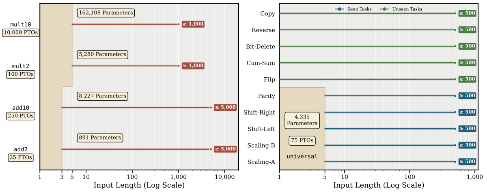
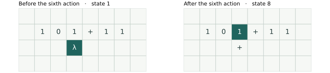
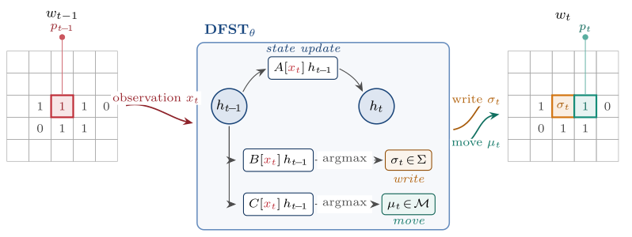
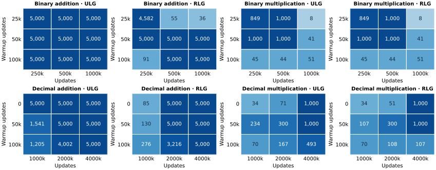
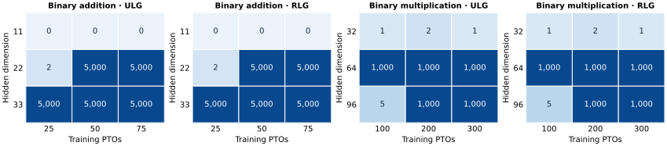
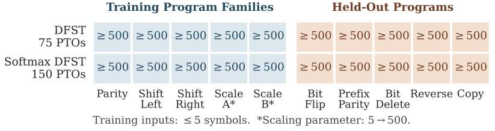
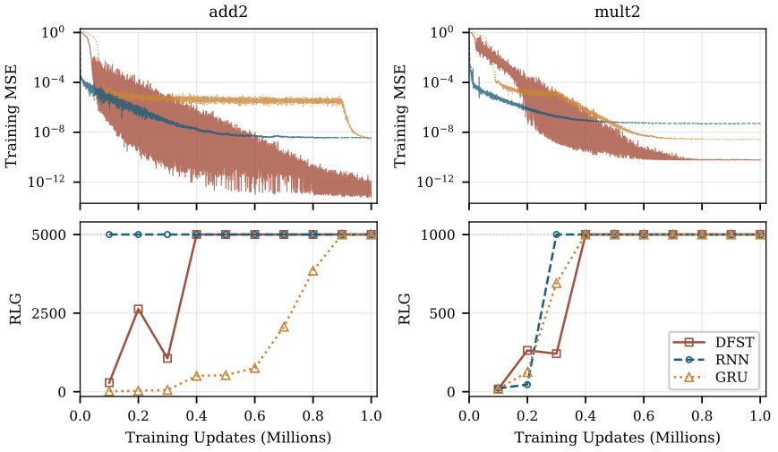
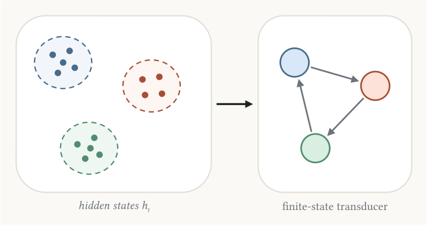
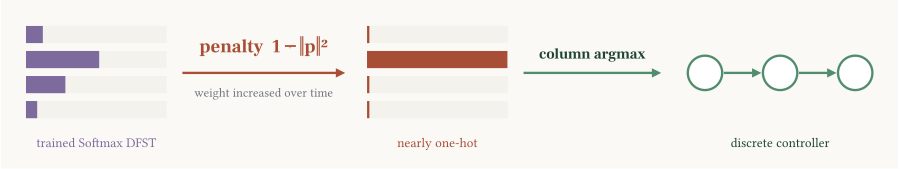

# DEL: Differentiable Exact Learning

**Hristo Papazov, Francesco D’Angelo, and Nicolas Flammarion · NeurIPS 2026**

How much can a learner recover from watching an algorithm run? In [Differentiable Exact Learning](https://arxiv.org/abs/2611.21486v1), we give a neural controller demonstrations of an expert acting on a grid. The learner sees every symbol the expert reads and writes, and every movement of the head. The expert’s internal states remain hidden. From these observations, we train controllers on short inputs, test on much longer inputs, and recover discrete algorithms whose behavior we can prove correct.


## Results at a Glance

The shaded regions below show the input lengths encountered during training. Selected controllers trained on additions of at most **3 digits** and multiplications of at most **5 digits** reach the evaluation caps of **5,000** and **1,000 digits per operand**, respectively. A single learned interpreter also reaches the **500-symbol** cap across ten Turing-machine programs, including five held-out programs. Every successful probe requires both the write and the motion to match the expert at every step.



## Paper Runs and Analyses

To trace a number from the paper back to an experiment, start with the [figure guide](paper/README.md). Each figure selection identifies the runs behind the plot. The [run guide](runs/README.md) explains how to load a selected checkpoint, inspect the training configuration, and read the saved evaluation. The [notebooks](notebooks/README.md) regenerate the plots from these artifacts without retraining.

For an exact-learning claim, follow the [analysis index](analyses/README.md) to the extracted transition table, the mathematical proof, and the executable checker for the task.

## Install

From the repository root, create a Python 3.10+ environment and install DEL with the notebook and development dependencies.

```sh
python -m venv .venv
source .venv/bin/activate
python -m pip install -e '.[dev,analysis]'
```

Training writes metrics and checkpoints locally by default. To follow a run in **Weights & Biases (W&B)**, install the tracking extra and sign in once.

```sh
python -m pip install -e '.[tracking]'
wandb login
```

Then append `run.wandb.enabled=true run.wandb.project=DEL` to a training command. Replace `DEL` with your preferred W&B project name.

## Quick Start

### Train from a Paper Configuration

Each released run includes a resolved `config.yaml`. For example, the following command retrains the binary-addition DFST used for metric extraction, selects an available device, and writes a fresh run under `outputs/reproductions/`. The paper configuration requests 250,000 updates.

```sh
del train --config runs/DFST/add2/warmup_50000_steps_250000/config.yaml \
  run.device=auto run.output_dir=outputs/reproductions
```

### Start a Custom Experiment

To design an experiment from scratch, export the complete package defaults to a new YAML file. Open the file and choose the expert and dataset under `data`, the controller under `model`, the optimizer and update budget under `training`, and the tests under `evaluation`. For example, `data.size` controls the number of demonstrations in a static dataset.

```sh
del config > my_experiment.yaml
# Edit my_experiment.yaml, then inspect the resolved settings and start training.
del config --config my_experiment.yaml
del train --config my_experiment.yaml
```

For a shorter configuration file, specify only the settings you want to change. DEL loads package defaults first, applies the YAML file next, and applies command-line overrides last. The [implementation guide](docs/reference.md) walks through the configuration fields, data generation, checkpoint loading, and evaluation commands.

## Repository Map

The directories below follow the path from a paper figure to the underlying experiment and implementation.

| Directory | What You Can Find |
|---|---|
| [`paper/`](paper/README.md) | Look up the runs behind each figure and the proof bundle behind each exact-learning claim. |
| [`runs/`](runs/README.md) | Load one of 69 released DFST or Softmax DFST checkpoints alongside the run’s configuration and final evaluation. |
| [`configs/`](configs/README.md) | Choose a training recipe by task and model family, or adapt a recipe for a new experiment. |
| [`notebooks/`](notebooks/README.md) | Rebuild a figure, inspect a controller, or repeat an extraction from a checkpoint. |
| [`analysis_outputs/paper_figures/`](analysis_outputs/paper_figures/) | Browse the rendered plots and read the numerical tables behind the figures. |
| [`analyses/`](analyses/README.md) | Inspect training histories, extracted transition tables, equivalence proofs, and executable checkers. |
| [`src/differentiable_exact_learning/`](src/differentiable_exact_learning/) | Follow an expert transition through the simulator, or inspect the neural models, trainer, evaluator, and extraction algorithms. |
| [`docs/`](docs/reference.md) | Look up CLI options, implementation details, and teaching-set constructions. |
| [`scripts/`](scripts/README.md) | Validate notebook workflows, export checkpoints, and prepare the browser viewer’s weights. |
| [`tests/`](tests/) | Find executable checks for expert behavior, model updates, training, evaluation, and analysis. |

## PTOs and Expert Controllers

A **policy-trajectory observation (PTO)** is a sequence of triples recording what an expert reads, what the expert writes, and where the head moves. Consider the sixth action when the binary-addition expert runs on `101+11`. The head reads a blank cell beneath the first operand, writes a plus sign, and moves up. The highlighted cell follows the head. The expert changes from state 1 to state 8, but the learner sees only the triple $(\lambda,+,\mathrm{U})$.



Try stepping through the same input in the [interactive grid explorer](https://fanagor.github.io/del/grid/). Select an expert to follow the state transitions, or load a trained controller to see the hidden vector and the matrices for the current read symbol. For arithmetic, the grid holds the operands and the working memory. For universal simulation, the grid also holds the transition table of the Turing machine to execute. The [expert programs](src/differentiable_exact_learning/data/transitions/) define the transition rules, and the [teaching-set guide](docs/teaching_sets.md) explains how selected inputs exercise particular rules.

## Neural Controllers and Training

### One Step of a DFST

A **Differentiable Finite-State Transducer (DFST)** is a neural controller with a hidden vector and three matrices for each possible read symbol. In the paper’s diagram below, follow a single observation from the highlighted grid cell on the left through the controller to the updated grid on the right.



At step $t$, the symbol $x_t$ selects a transition matrix $A[x_t]$, a write matrix $B[x_t]$, and a motion matrix $C[x_t]$. All three act on the **same pre-action hidden vector** $h_{t-1}$.

$$
h_t=A[x_t]h_{t-1},\qquad
\hat{s}_t=B[x_t]h_{t-1},\qquad
\hat{m}_t=C[x_t]h_{t-1}.
$$

During autonomous execution, the controller writes the symbol with the largest score in $\hat{s}_t$ and executes the motion with the largest score in $\hat{m}_t$. The resulting head position determines the next observation.

### From Scores to Probabilities

A **Softmax DFST** uses the same recurrence. For each read symbol $x$ and current-state index $j$, the model learns logits for each column of the three matrices and for the initial hidden state:

$$
P[x]_{:j}=\operatorname{softmax}(\Theta^P[x]_{:j}),\qquad
P\in\{A,B,C\},\qquad h_0=\operatorname{softmax}(\theta^h).
$$

Every column sums to one. The hidden vector therefore remains a distribution over states, and the two readouts give distributions over writes and motions. This structure gives the extraction procedure a direct way to read off discrete rules. The [model implementations](src/differentiable_exact_learning/models/) also include the RNN and GRU baselines, which predict the same actions from recurrent hidden states.

### Learning from Demonstrations

During training, the controller receives the expert’s read symbols in order. At each valid step, the learner predicts the expert’s write $s_{bt}$ and motion $m_{bt}$ for trajectory $b$ and time $t$. With one-hot targets $e_s$ and $e_m$ and a mask $M_{bt}$ that selects valid steps, the two-head mean-squared-error loss is

$$
\mathcal L =
\frac{\sum_{b,t} M_{bt}
\left(\lVert\hat{s}_{bt}-e_{s_{bt}}\rVert_2^2+
      \lVert\hat{m}_{bt}-e_{m_{bt}}\rVert_2^2\right)}
{2\sum_{b,t}M_{bt}}.
$$

Both heads contribute equally, and padding contributes zero. We train with Adam on short demonstrations, then evaluate the learned action rule on longer trajectories. The [optimization guide](docs/reference.md#objective-and-optimization) describes the training loop and learning-rate schedules.

## Length Generalization

### Binary and Decimal Arithmetic

How far does a controller trained on short operands continue to match the expert? At each candidate length $L$, **uniform length generalization (ULG)** tests ten random pairs with exactly $L$ digits per operand. **Robust length generalization (RLG)** additionally tests every ordered pair of repdigits, such as `999+111` at length three. Repeating a single digit can sustain a carry or another computational pattern that random inputs rarely exercise for long. Each cell below gives the length reached by the evaluation search, in digits per operand.

For **ordinary DFSTs**, compare the ULG and RLG panels for the same task and training schedule. Several schedules reach both caps across binary and decimal arithmetic. A longer training budget alone does not guarantee better generalization.



For **Softmax DFSTs**, the update budget stays fixed at 100,000. Within each panel, rows vary the hidden dimension and columns vary the number of training PTOs. On binary addition, the 11-dimensional runs record zero for both ULG and RLG across all three dataset sizes. Increasing the dimension to 22 and supplying 50 demonstrations reaches 5,000 digits on both tests. The multiplication panels show how capacity and data affect the second binary task.



The [DFST arithmetic notebook](notebooks/dfst_arithmetic.ipynb) and [Softmax arithmetic notebook](notebooks/dfst_softmax_arithmetic.ipynb) connect each cell to a specific run. A successful cap probe records the longest length tested. The [evaluation guide](docs/reference.md#evaluation) explains the search and the exact action-matching criterion.

### Universal Simulation

For the universal task, we vary the program on the grid while keeping the learned controller fixed. A 15-dimensional DFST trained on 75 PTOs and a 30-dimensional Softmax DFST trained on 150 PTOs both reach the 500-symbol cap on all ten evaluation programs. Training used five programs and input words of at most five symbols. The figure compares both controllers on familiar and held-out computations.



To compare the remaining training-set sizes and dimensions, open the [DFST universal notebook](notebooks/dfst_universal.ipynb) or the [Softmax universal notebook](notebooks/dfst_softmax_universal.ipynb).

## Training Dynamics Across Controller Families

The final evaluations tell us how far a controller generalizes. Checkpoints show when that ability emerges. The upper panels below track training loss on short demonstrations. The lower panels track RLG on long, structured inputs every 100,000 updates. DFST, RNN, and GRU each reach the binary-addition and binary-multiplication caps within one million updates, using 25 and 100 training PTOs, respectively.



The runs use different dimensions, seeds, and schedules. The [six saved histories](analyses/README.md#training-dynamics) give the settings behind each curve, and the [training-dynamics notebook](notebooks/training_dynamics.ipynb) also plots ULG.

## Extracting Discrete Controllers

**Metric extraction** starts from the hidden states visited by a trained DFST during autonomous execution. We link nearby vectors, treat connected components as candidate discrete states, and use observed reads and actions to construct transitions. When two transitions conflict, the procedure tests whether further merging resolves the conflict and retries with a smaller distance threshold when necessary. The [metric-extraction notebook](notebooks/metric_FST_extraction.ipynb) shows the recovered graph and how the graph changes as more trajectories enter the sample.



**Softmax annealing** starts from probability columns. We continue training with a progressively stronger penalty that favors concentration on one entry per column. Column-wise argmax then selects one successor, write, and motion for each state and read symbol. The [annealing notebook](notebooks/anneal_dfst_softmax_to_fst.ipynb) lets you inspect the probability columns during training and compare the final transition table with the expert.



## Proofs of Expert Equivalence

Length tests cover finite samples. To prove agreement for every input in a task’s domain, we relate the extracted states and grid configurations to phases of the expert algorithm. Each permitted transition preserves the relation and produces the same write and motion. Induction then extends agreement through the entire execution, including the stopping action.

For a worked example, open the [binary-addition case](analyses/metric_extraction/DFST/add2/warmup_50000_steps_250000/README.md). The proof covers arbitrary nonempty binary operands, including unequal lengths and leading zeros. You can inspect the transition table, read the proof, and run the checker for the finite obligations.

The [proof index](analyses/README.md) collects five metric-extraction proofs and three annealing proofs, with the input domain for each recovered controller. The [paper](https://arxiv.org/abs/2611.21486v1) gives the additional stability or leakage assumptions needed to transfer these guarantees to continuous neural execution.
